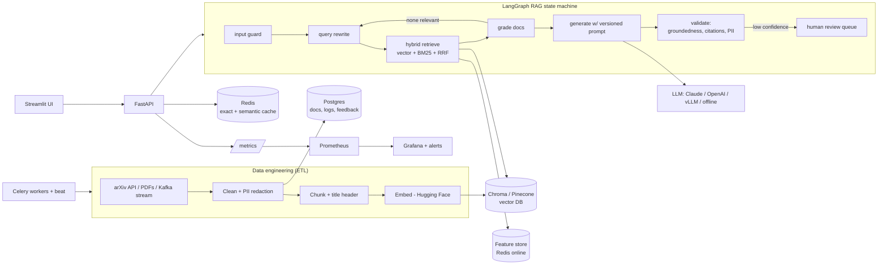

# 📄 PaperPilot — a production-style RAG assistant for AI research papers

Ask questions about AI/ML papers (arXiv, PDFs) and get **grounded, cited answers** with a
confidence score, a per-request trace, cost accounting, guardrails, and a human-review loop.

It's built to show the full AI-engineering lifecycle end-to-end: **data → retrieval → LLM →
evaluation → safety → production ops** — and it **runs in 60 seconds with no API keys** (offline
mode), then scales up to Docker Compose, Kubernetes and real LLMs by changing environment variables.

```bash
pip install -r requirements-dev.txt
python scripts/demo.py          # 13-step narrated walkthrough of every feature
pytest -q                       # 22 tests
python -m eval.run_eval --gate  # evaluation report + CI quality gate
```

---

## Architecture



**Request lifecycle (`POST /ask`)**: rate-limit → A/B bucket assignment → cache lookup →
LangGraph (guard → rewrite → retrieve → grade → [retry] → generate → validate → [human review])
→ log to SQL → metrics → response with answer, sources, groundedness, trace, cost.

---

## Topic coverage map

Every item from the AI-engineer skill list maps to real, running code:

| Area | Topic | Where |
|---|---|---|
| **GenAI & LLM apps** | Prompt engineering (grounding, refusal path, delimiters, few-shot, versioning) | `app/llm/prompts.py` |
| | Embeddings & vector representations | `app/embeddings.py` |
| | RAG (Corrective RAG + self-check) | `app/rag_graph.py` |
| | Vector DBs: Chroma (default), Pinecone (same interface), Weaviate notes | `app/vectorstore.py` |
| | Document loaders & chunking (recursive vs sentence, overlap, contextual headers) | `app/ingestion/loaders.py`, `chunking.py` |
| **Stack & tools** | FastAPI service with OpenAPI docs | `app/main.py` |
| | LangGraph orchestration + LangChain retriever interface | `app/rag_graph.py`, `app/integrations/langchain_retriever.py` |
| | LlamaIndex comparison pipeline | `app/integrations/llamaindex_pipeline.py` |
| | Hugging Face (sentence-transformers, cross-encoder reranker) | `app/embeddings.py`, `app/retrieval.py` |
| | Streamlit UI | `ui/streamlit_app.py` |
| | Docker, Docker Compose, Kubernetes (HPA, probes, StatefulSets) | `Dockerfile`, `docker-compose.yml`, `k8s/` |
| | Cloud (AWS EKS/RDS/ElastiCache/MSK/Bedrock mapping) | `deploy/aws/README.md` |
| **Data engineering** | Data collection & APIs (arXiv with retries/backoff) | `app/ingestion/loaders.py` |
| | ETL pipeline (idempotent via content hashes) | `app/ingestion/pipeline.py` |
| | Cleaning & preprocessing, dedup, data-quality report | `app/ingestion/cleaning.py` |
| | SQL (Postgres/SQLite via SQLAlchemy) & NoSQL (Redis) | `app/db.py`, `app/cache.py` |
| | Streaming (Kafka consumer groups, micro-batching, DLQ; Kinesis mapping) | `app/streaming/kafka_pipeline.py` |
| | Feature store (offline → online; Feast definitions) | `app/feature_store.py`, `feature_repo/` |
| | Data versioning (DVC pipeline, params, metrics) | `dvc.yaml`, `params.yaml` |
| **Production systems** | System design & modular microservices (api / worker / ui / data stores) | whole repo |
| | Caching (Redis exact + semantic), queues (Celery on Redis/RabbitMQ) | `app/cache.py`, `app/workers/tasks.py` |
| | Model serving (vLLM / TGI via OpenAI-compatible API, FastAPI) | `app/llm/client.py`, compose `gpu` profile |
| | CI/CD (lint → tests → eval gate → build & push) | `.github/workflows/ci.yml` |
| | Monitoring & logging (Prometheus, Grafana dashboard, alerts, JSON logs) | `app/observability.py`, `monitoring/` |
| **Eval & reliability** | LLM evaluation (custom metrics + RAGAS/DeepEval hooks) | `eval/run_eval.py` |
| | Prompt testing & A/B testing (deterministic bucketing, z-test, SQL report) | `app/ab_testing.py`, `eval/run_eval.py --compare` |
| | Hallucination detection & guardrails | `app/guardrails.py` |
| | Observability (traces, logs, metrics) | `app/observability.py` |
| | Cost & latency optimisation (cache, token/cost metrics, model routing) | `app/cache.py`, `app/llm/client.py` |
| | Continuous improvement loop (feedback → review → eval set → feature store) | `/feedback`, `/review`, `app/feature_store.py` |
| **Safety & product** | Prompt injection (direct + indirect) & data security | `app/guardrails.py` |
| | Human-in-the-loop review queue | `app/rag_graph.py`, `/review`, UI "Human review" tab |
| | Privacy & compliance (PII redaction at ingest, GDPR erasure endpoint) | `app/ingestion/cleaning.py`, `DELETE /documents/{id}` |
| | UX for AI (citations, confidence badge, feedback, transparent review state) | `ui/streamlit_app.py` |
| | Problem framing & business impact | `docs/DISCUSSION_GUIDE.md` |

---

## Run it

### 1. Local, zero keys (fastest)
```bash
python -m venv .venv && source .venv/bin/activate
pip install -r requirements-dev.txt
python -m app.ingestion.pipeline --source sample     # build the index
uvicorn app.main:app --reload                        # http://localhost:8000/docs
pip install streamlit && streamlit run ui/streamlit_app.py   # http://localhost:8501
```
Offline mode uses a deterministic hashing embedder and an **extractive** answerer, so everything
(including CI) runs free. It's for plumbing and demos — switch on real models for real quality.

### 2. Real models
```bash
pip install -r requirements-ml.txt          # Hugging Face embeddings
export EMBEDDING_BACKEND=hf
export LLM_PROVIDER=anthropic ANTHROPIC_API_KEY=sk-...   # or openai / vllm
rm -rf data/chroma data/paperpilot.db && python -m app.ingestion.pipeline --source sample
python -m app.ingestion.pipeline --source arxiv --query "cat:cs.CL AND abs:retrieval" --max 50
```
> Changing the embedding model means re-indexing — vectors from different models aren't comparable.

### 3. Full stack with Docker Compose
```bash
cp .env.example .env             # add a key if you want a real LLM
docker compose up --build        # API :8000, UI :8501, Grafana :3000, Prometheus :9090
curl -X POST localhost:8000/ingest -H 'content-type: application/json' -d '{"source":"sample"}'
docker compose --profile streaming up   # + Kafka
docker compose --profile gpu up         # + vLLM serving Mistral-7B (NVIDIA GPU)
```

### 4. Kubernetes
```bash
kubectl apply -f k8s/            # namespace, config, API (+HPA, ingress), workers, data stores
```

---

## API

| Method | Path | Purpose |
|---|---|---|
| POST | `/ask` | `{question, user_id?, prompt_version?, filters?, use_cache?}` → answer, sources, groundedness, status, trace, cost |
| POST | `/ingest` | `{source: "sample"\|"arxiv", query?, max_results?, run_async?}` |
| POST | `/upload` | multipart PDF / MD / TXT |
| POST | `/feedback` | `{query_id, rating: 1\|-1, comment?}` |
| GET / POST | `/review`, `/review/{id}` | human-in-the-loop queue |
| DELETE | `/documents/{doc_id}` | GDPR erasure |
| GET | `/stats/ab` | prompt-variant report |
| GET | `/health`, `/ready`, `/metrics` | probes & Prometheus |

---

## Repo layout
```
app/
  config.py            env-driven settings
  observability.py     JSON logs, Prometheus metrics, tracing spans
  ingestion/           loaders → cleaning → chunking → pipeline (ETL)
  embeddings.py        HF / hashing embedders
  vectorstore.py       Chroma + Pinecone behind one interface
  retrieval.py         BM25 + vector + RRF fusion (+ cross-encoder rerank)
  llm/                 prompts (versioned) + multi-provider client
  guardrails.py        injection, PII, groundedness, citations
  rag_graph.py         LangGraph state machine
  cache.py             exact + semantic cache
  db.py                SQL models + A/B analytics query
  feature_store.py     offline → online features
  ab_testing.py        bucketing + significance test
  workers/ streaming/ integrations/
eval/                  golden set, red-team set, harness + quality gate
ui/                    Streamlit app
k8s/ monitoring/ deploy/ feature_repo/ .github/
docs/                  CODE_WALKTHROUGH.md, DISCUSSION_GUIDE.md
```

See **[docs/CODE_WALKTHROUGH.md](docs/CODE_WALKTHROUGH.md)** for a file-by-file explanation and
**[docs/DISCUSSION_GUIDE.md](docs/DISCUSSION_GUIDE.md)** for the demo script and Q&A prep.
